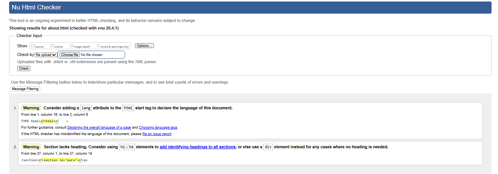
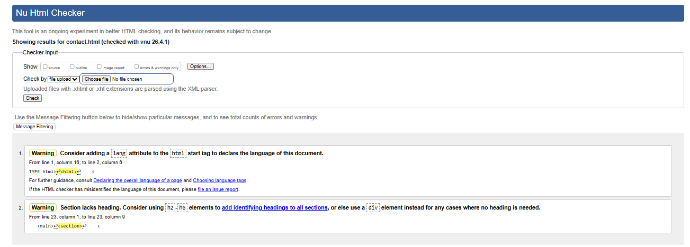
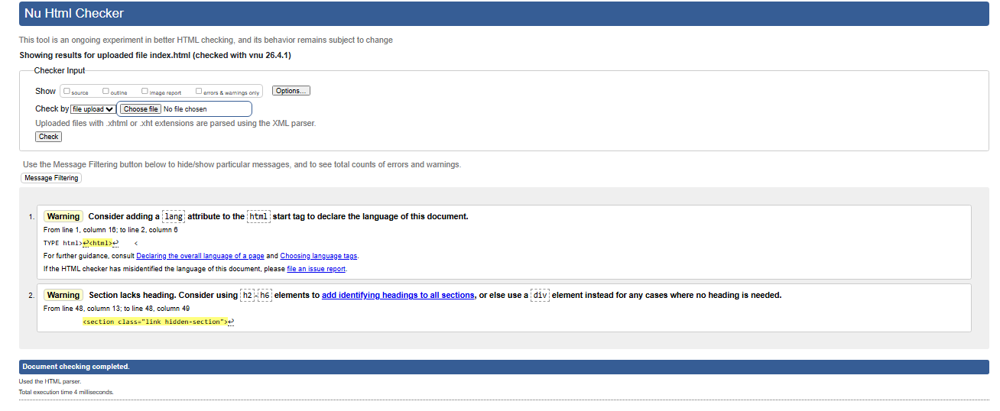
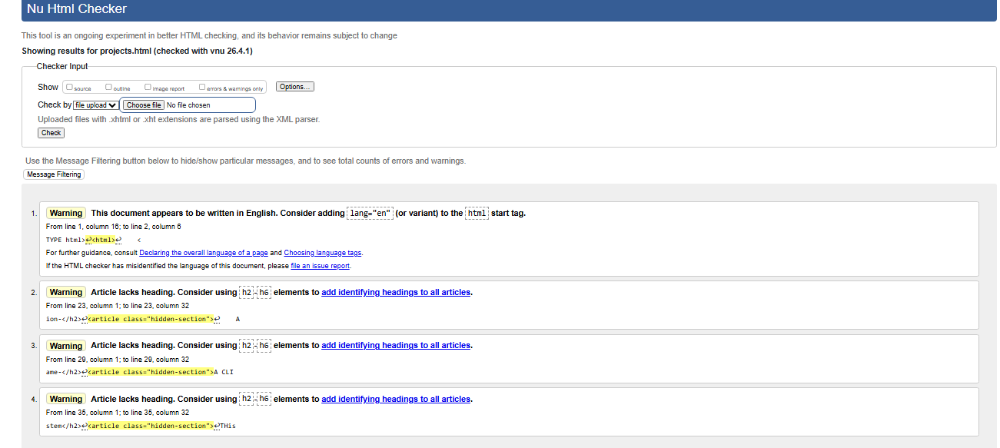
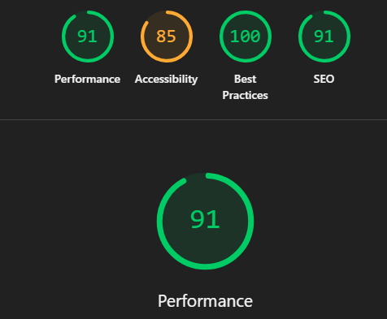
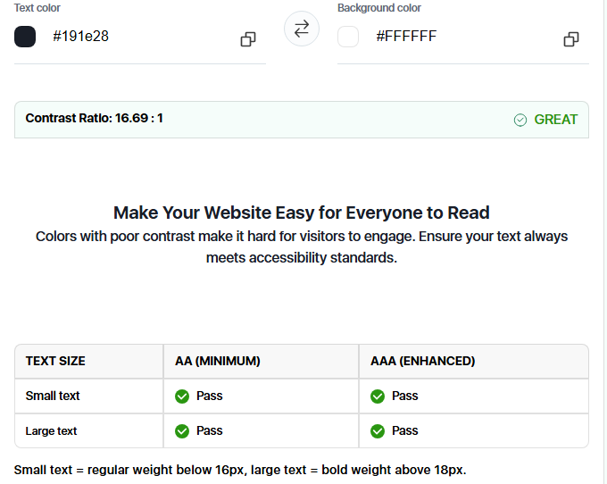
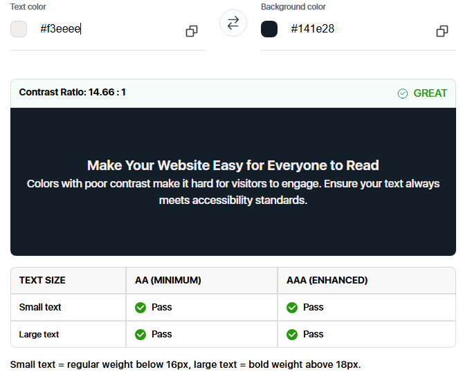

# Introduction to Software Systems S26 
## Assignment 2

The assignment is available [here](https://arihant25.github.io/iss-s26-a2/).

[This](https://hackmd.io/tNHsqwNhRoy12Oql-5cpwQ) is where you can ask questions about it, for which you will receive answers [here](https://hackmd.io/KiR2DviZT8OyzNutMPdK9w).

Good luck, have fun!

1. Vardaan Goel - 2025117001

2. Group A: A2
Approach - Attached event listener to scroll that calculates scroll depth as percentage of total scrollable height, updating width of progress bar in real time. As mentioned in constraints, I separated the sessionStorage into its separate module. The exact Y coordinate is saved for the user. When user returns to the page, prompt appears asking the user to resume where he/she left off. On clicking confirm, window.scrollTo() function helps to return to the last location.

Group B:B2
Approach - Attached a single one click listener to the <ul> container. When clicked, the aria-expanded of the .tl_button is toggled. To achieve good expansion animation, I used max-height feature in CSS. Using Java Script, I read the scroll height and set it as new max-height value to expand it, or if closing, change it to 0px to collapse.

3. I used 'Montserrat' for headings and 'Open Sans' for body. I tried many different textx, but this combo looked most visually appealing.

4. Hero Staggered Sequence - Elements are animated in order - name->detail->buttons. It provides in catching attention of the viewer order wise, and not putting out all information at once.

Buttons Hover - It increases interactivity. It also tells that this thing is clickable. Ofcourse makes it look visually appealing.

Scroll Animation - Information coming on screen while scrolling makes it look like reading a proffesional text. It is a more immersive way to tell about yourself.

Reduced Motion - Helps in increasing accessiblity. Every type of user, irrespective of any disorder should be able to navigate the site safely.

5. 

6. 

7. 

8. 

9. 
